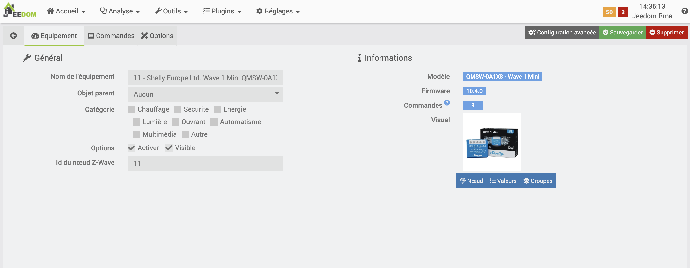
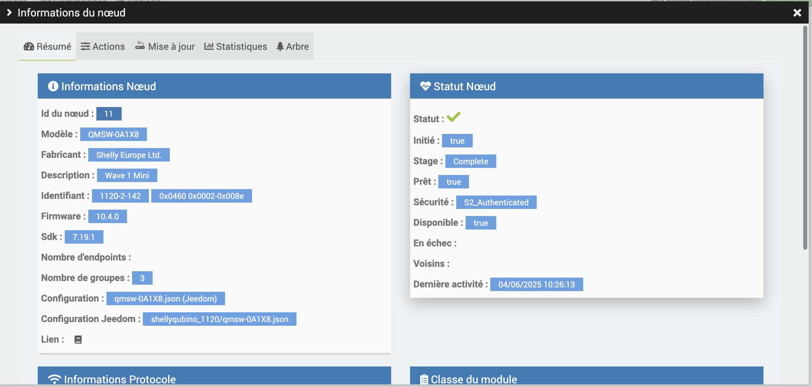
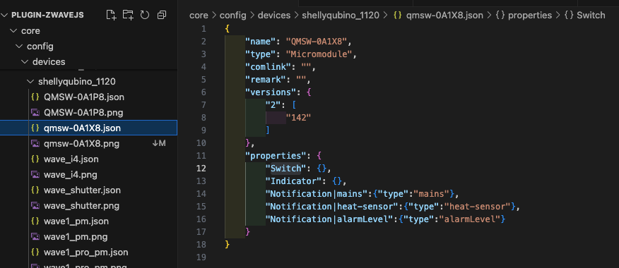
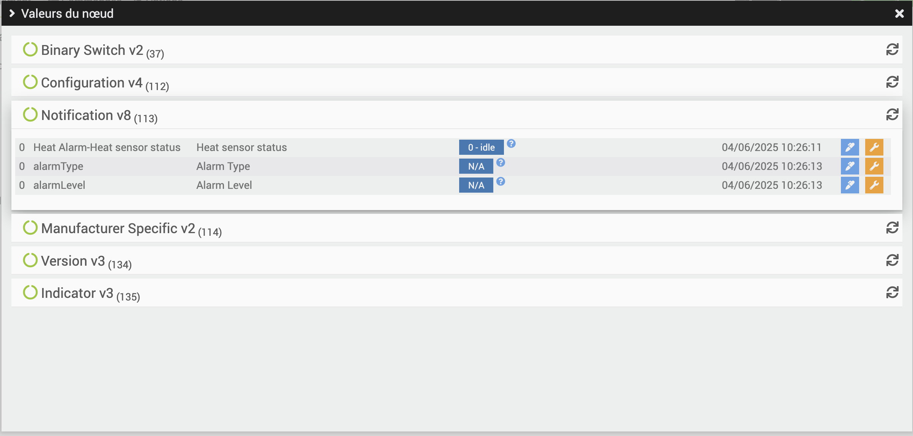
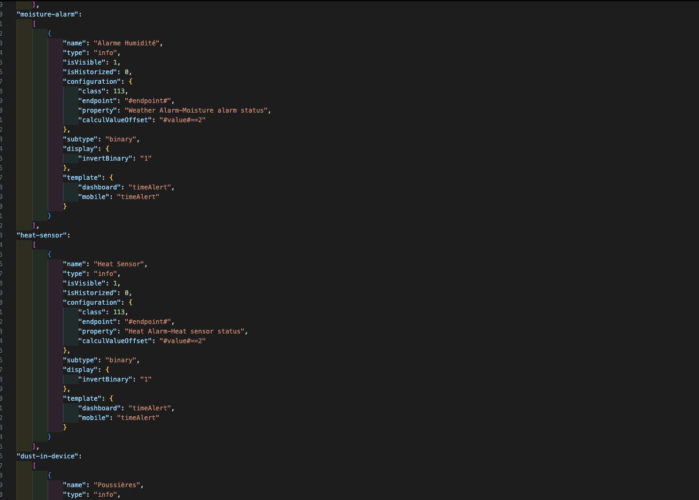

# Procedimiento de integración

Para crear un archivo de configuración para un nuevo producto, empieza por añadir ese producto a Jeedom.



Una vez en la página del producto, haz clic en el botón **«Nodo»** para que aparezca esta ventana modal:



La información importante que hay que recopilar es:

- **Identificador:** XXX - XXX - XXX
- **Configuración:** XXX.json

El campo **Configuración** indica el nombre que se le debe dar al archivo de configuración.
Ejemplo: `qmsw-0A1X8.json`

El campo **Identificador** permite determinar:
- la carpeta en la que se va a crear el archivo;
- la versión que hay que indicar en la configuración.

El **primer dígito** del identificador corresponde a la carpeta.
Ejemplo: con `1120`, hay que crear el archivo `qmsw-0A1X8.json` en la carpeta `shellyqubino_1120`.

> ⚠️ **Atención:** El nombre de la carpeta no siempre coincide con el nombre del fabricante. ¡Hay que **guiarse por el número**!
> Ejemplo: *Wintop* tiene el número `151`, que hace referencia a la carpeta `schlage_151`.

El **segundo y tercer dígito** del identificador corresponden a la **versión**.
Ejemplo: Versión `"2"` : `[ "142" ]`



- Para el campo `"name"`, utilice la ficha del producto.
Ejemplo: `"QMSW-0A1X8"`
- Para el campo `"type"`, indique el tipo de producto: *Micromódulo, relé, tipo de apertura*, etc.

---

## Creación de comandos

La creación automática de órdenes se basa en el campo `"properties"`.

Empieza haciendo clic en el botón **«Valores»**, lo que abrirá una ventana emergente similar a esta:



Los campos **«Manufacturer Specific»**, **«Configuration»** y **«Version»** pueden omitirse.

Los datos interesantes son:
- **nombre de los comandos**
- su **clase**

En el caso de las **notificaciones**, se desea, por ejemplo, crear comandos para las alarmas de calor, así como el nivel y el tipo de alarma.

Para ello, hay que consultar el archivo `Notification.json` en la carpeta `properties`.



Una vez en este archivo, identifica el tipo de propiedad que se va a utilizar.
Ejemplo: para crear un comando de alarma `"heat-sensor"`, se añade lo siguiente al archivo de configuración:

```json
"Notification|heat-sensor": {
  "type": "heat-sensor"
}
```
