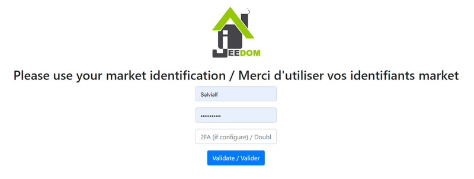
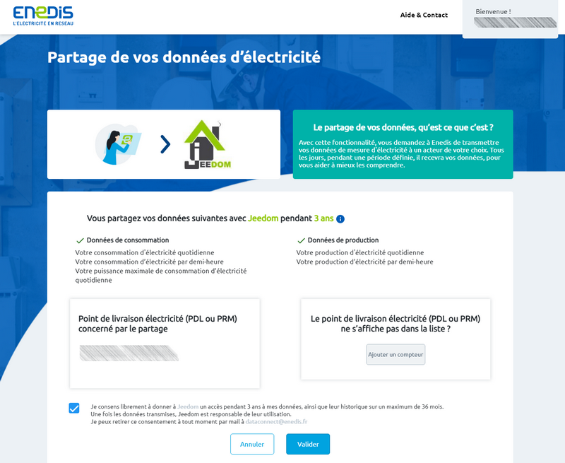
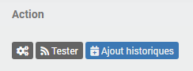
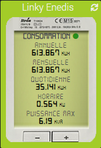
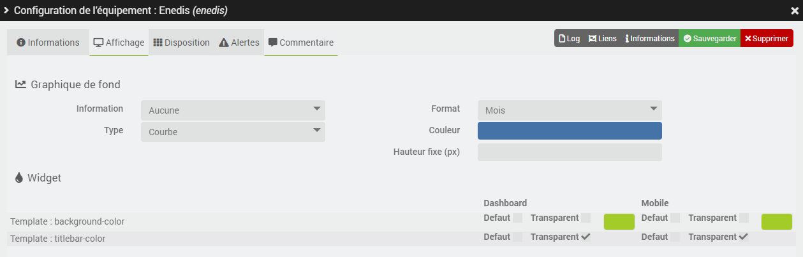

# Complemento de Enedis

Complemento que permite recuperar los datos de consumo eléctrico de los contadores inteligentes *(por ejemplo, Linky)* mediante la consulta del [cuenta de cliente **Enedis**](https://mon-compte.enedis.fr/auth/XUI/#login/&realm=/enedis&forward=true){:target="\_blank"}.

Es posible acceder a los datos de **consumo**, de **producción** o a ambos tipos de medición directamente desde un equipo.

Se han registrado 5 datos de consumo, y los mismos 4 sin la potencia máxima en generación:
- el **consumo horario** por media hora *(en kW)*.
- el **consumo diario** *(en kWh)*.
- el **consumo mensual** *(en kWh)*.
- el **consumo anual** *(en kWh)*.
- la **potencia máxima** *(en kVA)*.

Dado que Enedis no facilita los datos en tiempo real, el complemento recupera cada día los datos del día anterior. Mientras no los haya recuperado todos, vuelve a consultar los servidores de Enedis cada 30 minutos hasta las 19:00 h, y reanuda la consulta a la mañana siguiente.

En cada recuperación, se consultan los datos de día, mes, año y potencia máxima desde el 1 de enero del año en curso, así como los datos horarios de los últimos 7 días. Los historiales ya registrados se reajustan según los datos de Enedis: cualquier dato facilitado con retraso o corregido por Enedis actualiza los valores correspondientes.

# Configuración

Al igual que cualquier plugin de Jeedom, el plugin **Enedis** debe activarse tras su instalación.

## Configuración del plugin

Si aún no lo has hecho, empieza por autorizar el intercambio de datos entre Enedis y Jeedom haciendo clic en el botón **Autorizar el acceso a los servidores de Enedis: accedo a mi área de cliente de Enedis** desde la página de configuración del complemento:

A continuación, se te redirigirá a esta página, en la que deberás introducir **tus datos de acceso al Jeedom Market** y, a continuación, hacer clic en el botón **Validar**:

Redirección a la página de consentimiento de Enedis, en la que hay que **marcar la casilla** y hacer clic en **Validar**:

Una vez validado el intercambio de datos, aparecerá esta página:

>**IMPORTANTE**
>
>Si no consigues acceder a alguna de estas páginas, desactiva el bloqueador de anuncios del navegador.

## Configuración del equipo

Para acceder a los distintos dispositivos de **Enedis**, dirígete al menú **Complementos → Energía → Enedis**. El botón **+ Añadir** te permite añadir un nuevo contador o PDL.

Una vez autorizado el intercambio de datos desde la página de configuración del complemento, solo queda introducir **el número de identificación del punto de entrega** correspondiente *(PDL)* y el **tipo de medición** que se desea recuperar.

Al realizar la primera copia de seguridad de un equipo activo y configurado, el complemento creará automáticamente los comandos necesarios e integrará los historiales disponibles en la página web de Enedis desde el 1 de enero del año en curso. Este proceso puede tardar varios minutos; puedes seguir su progreso desde el menú **Análisis → Registros** *(registros en ``debug``)*.

Si no ha activado **el registro y la recopilación del consumo por horas** en su cuenta de Enedis, deberá marcar la casilla **Datos por horas: Desactivar** para que no se creen los comandos correspondientes.

# Agregar datos

Es posible integrar, si se desea, los historiales de años anteriores desde los servidores de Enedis. Para ello, basta con hacer clic en el botón azul **Añadir historiales** desde la pestaña **Comandos** de un equipo, en la columna **Acción** del comando correspondiente:

Para los comandos «día» y «potencia máxima», elige el año de inicio entre los tres años anteriores: los datos de día, mes, año y potencia máxima se incluirán desde el 1 de enero de ese año hasta el 1 de enero del año en curso.

Para los comandos programados, elige la fecha de inicio, dentro de los últimos tres años: los datos se integrarán en los siete días siguientes, que es el plazo máximo establecido por Enedis.

A continuación, haz clic en **Aceptar** para iniciar la integración.

# Plantilla de widget

El complemento ofrece la posibilidad de mostrar los datos de consumo y/o producción en una plantilla de widget que imita el aspecto de un contador *Linky*, tanto en la versión de escritorio como en la móvil. Al hacer clic en el botón «**- \| +**» se puede cambiar de consumo a producción para aquellos que tengan acceso a ambos tipos de mediciones. Además, un indicador permite saber si los datos están actualizados o no *(verde = todos los datos están actualizados; naranja = algunos datos no están actualizados; rojo = ningún dato está actualizado)*.

La plantilla del widget está activada por defecto. Para volver al widget estándar de Jeedom, basta con desmarcar la casilla **Plantilla del widget** en la pestaña **Información** de la configuración avanzada del dispositivo.

Los colores de la plantilla se configuran en la pestaña **Visualización** de la configuración avanzada del dispositivo, por separado para las versiones de escritorio y móvil:
- el color de fondo *(`Template : background-color`)*, verde en el contador *(163, 204, 40)* cuando la casilla **Por defecto** está marcada.
- el color de la barra de título *(`Template : titlebar-color`)*, transparente en el momento de la creación del equipo.

# Preguntas más frecuentes

>**Me aparecen errores de recuperación de datos en los registros, aunque se pueden ver en la página web de Enedis**
>
>A veces es necesario acceder directamente a la página web de Enedis para aceptar las últimas condiciones generales de uso y poder volver a acceder a los datos. En ocasiones también es necesario restablecer la conexión entre Jeedom y Enedis desde la página de configuración del complemento.
