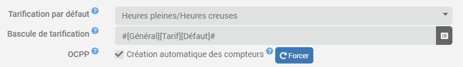
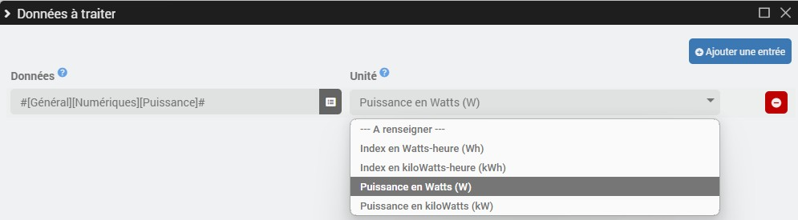
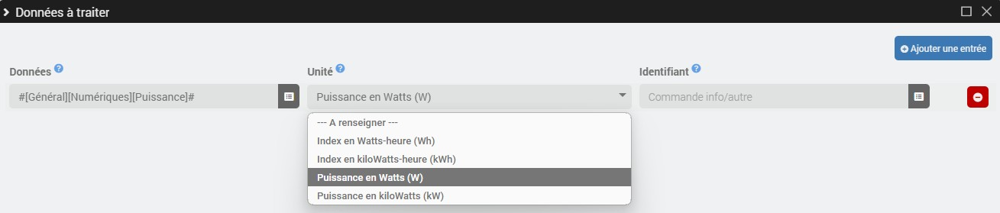

# Virtuelles Zähler-Plugin

Mit dem Plugin **Virtueller Zähler** können Energiezähler in Kilowattstunden aus Brutto-Zählerständen *(Wh/kWh)* und/oder Leistungswerten *(W/kW)* erstellt werden, sei es im Einheits- oder im Spitzen-/Nebenzeittarif. Dieses Plugin ermöglicht zudem die Erstellung von Zählern, die mit einer Kennung *(Benutzerdefiniert/OCPP)* verknüpft sind.

>**WICHTIG**
>
>Die Optionen zum OCPP-Protokoll sind nur sichtbar, **wenn das OCPP-Plugin installiert ist**.

# Konfiguration

## Plugin-Setup

- **Standardtarif**: Wählen Sie den Standardtarif für die virtuellen Zähler aus *(Einheitstarif oder Spitzen-/Nebenzeiten-Tarif)*.
- **Tarifumschaltung**: Bei einer Standardtarifierung nach Spitzen- und Nebenzeiten wählen Sie den Info-/Binärbefehl für die Standard-Tarifumschaltung aus *(1 = Spitzenzeiten / 0 = Nebenzeiten)*.
- **OCPP**:
  - **Automatische Erstellung von Zählern**: Aktivieren Sie das Kontrollkästchen, um bei jeder neuen OCPP-Transaktion automatisch Zähler pro Benutzer zu erstellen.
  - **Erzwingen**: Erstellt sofort alle OCPP-Zähler der autorisierten Benutzer, ohne dass auf eine Transaktion gewartet werden muss.

## Gerätekonfiguration

Um einen neuen virtuellen Zähler hinzuzufügen, klicken Sie auf die Schaltfläche **+Hinzufügen**.

- **Zählertyp**: Wählen Sie den Zählertyp aus *(Standard/Benutzerdefiniert/OCPP)*.
- **Preisgestaltung**: Passen Sie die Preisgestaltung bei Bedarf an.
- **Tarifumschaltung**: Bei einer Tarifgestaltung mit Spitzen- und Nebenzeiten muss der Info-/Binärbefehl für die Tarifumschaltung gegebenenfalls angepasst werden.

---

- **ID**: Bei benutzerdefinierten oder OCPP-Zählern geben Sie bitte die zu validierende ID an, um die Transaktion zu verbuchen.

### Zu verarbeitende Daten

Virtuelle Zähler vom Typ **OCPP** erfassen automatisch die Transaktionsdaten jedes Nutzers.

In allen anderen Fällen müssen Sie im Abschnitt **Zu bearbeitende Daten** auf die Schaltfläche **Bestellungen verwalten** klicken und anschließend **Eintrag hinzufügen** wählen.

- **Standardzähler**:

	- **Daten**: Info-/Zahlensteuerung der zu verarbeitenden Rohdaten.
	- **Einheit**: Wählen Sie die Einheit aus, falls sie nicht automatisch erkannt wird *(Wh/kWh/W/kW)*.

- **Individuell angepasste Zähler**:

	- **Daten**: Info-/Zahlensteuerung der zu verarbeitenden Rohdaten.
	- **Einheit**: Wählen Sie die Einheit aus, falls sie nicht automatisch erkannt wird *(Wh/kWh/W/kW)*.
	- **ID**: Geben Sie den Befehl „info/autre“ ein, der die aktuelle ID angibt *(der Wert muss mit der auf Geräteebene definierten ID übereinstimmen, damit die Transaktion verbucht wird)*.

## Bestellungen

Je nach Preisgestaltung werden die folgenden Bestellungen erstellt:

- **Einheitspreis**:
  - **Zählerstand** *(Info/digital in kWh)*.

- **Spitzenzeiten/Nebenzeiten**:
  - **Spitzenlast-Index** *(Info/digital in kWh)*.
  - **Niedertarif-Index** *(Info/digital in kWh)*.
  - **Gesamtverbrauch** *(Info/digital in kWh)*.

Und je nach Zählertyp:

- **OCPP-Zähler und benutzerdefinierte Zähler *(sofern Rohdaten in W oder kW vorliegen)***:
  - **Leistung** *(Angabe/numerisch in W)*.
