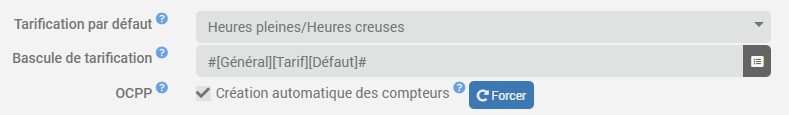
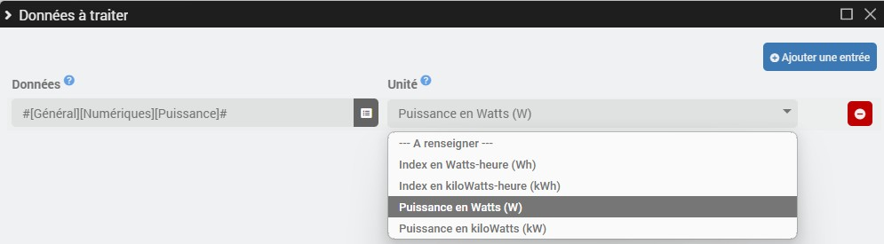
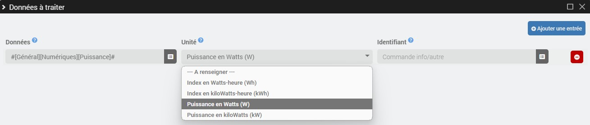

# Virtual Counter Plugin

The **Virtual Meter** plugin allows you to create energy meters in kilowatt-hours based on raw readings *(Wh/kWh)* and/or power ratings *(W/kW)*, whether using a flat rate or peak/off-peak rates. This plugin also allows you to create meters linked to an identifier *(Custom/OCPP)*.

>**IMPORTANT**
>
>Options related to the OCPP protocol are visible only **if the OCPP plugin is installed**.

# Setup

## Plugin Configuration

- **Default Billing**: Select the default billing method for virtual meters *(flat rate or peak/off-peak rates)*.
- **Rate Switch**: If the default rate is based on peak/off-peak hours, select the default rate switch info/binary command *(1=peak hours/0=off-peak hours)*.
- **OCPP**:
  - **Automatic Meter Creation**: Check the box to automatically create meters per user for all new OCPP transactions.
  - **Force**: Instantly creates all OCPP counters for authorized users without having to wait for a transaction.

## Equipment configuration

To add a new virtual meter, click the **+Add** button.

- **Meter Type**: Select the meter type *(Standard/Custom/OCPP)*.
- **Pricing**: Adjust pricing as needed.
- **Rate Switching**: If peak/off-peak rates apply, adjust the rate switching info/binary command as needed.

---

- **ID**: For custom or OCPP meters, enter the ID to be validated in order to record the transaction.

### Data to be processed

**OCPP**-type virtual meters automatically retrieve transaction data from each user.

For the others, click the **Manage Commands** button in the **Data to Process** section, then **Add an Entry**.

- **Standard meters**:

	- **Data**: Information/numeric command for the raw data to be processed.
	- **Unit**: Select the unit if it is not detected automatically *(Wh/kWh/W/kW)*.

- **Custom counters**:

	- **Data**: Information/numeric command for the raw data to be processed.
	- **Unit**: Select the unit if it is not detected automatically *(Wh/kWh/W/kW)*.
	- **ID**: Enter the "info/other" command specifying the current ID *(the value must match the ID defined for the device for the transaction to be recorded)*.

## Orders

The following commands are created based on pricing:

- **Flat rate**:
  - **Meter Reading** *(Information/Digital in kWh)*.

- **Peak Hours/Off-Peak Hours**:
  - **Peak-hour index** *(Info/digital in kWh)*.
  - **Off-peak hours index** *(Info/digital in kWh)*.
  - **Total reading** *(Info/digital in kWh)*.

And depending on the type of meter:

- **OCPP meters and custom meters *(if raw data is in W or kW)***:
  - **Power** *(Info/numeric in W)*.
