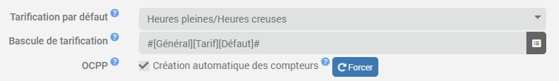
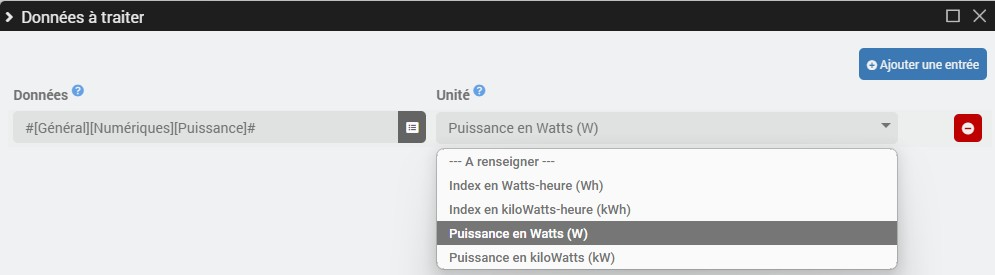
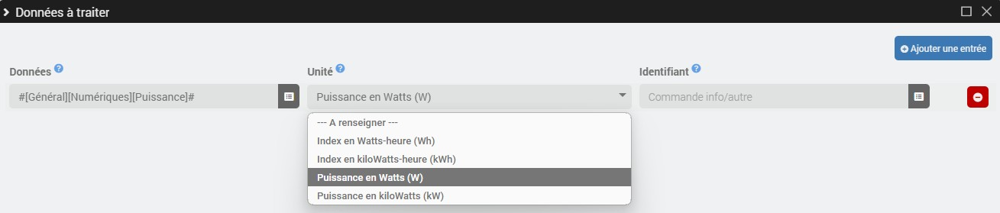

# Complemento de contador virtual

El complemento **Contador virtual** permite crear contadores de energía en kilovatios-hora a partir de lecturas brutas *(Wh/kWh)* y/o potencias *(W/kW)*, ya sea con tarifa única o con horas punta/horas valle. Este complemento también permite crear contadores vinculados a una identificación *(Personalizada/OCPP)*.

>**IMPORTANTE**
>
>Las opciones relacionadas con el protocolo OCPP solo son visibles **si está instalado el complemento OCPP**.

# Configuración

## Configuración del complemento

- **Tarificación por defecto**: Selecciona la tarificación por defecto de los contadores virtuales *(tarifa única o horas punta/horas valle)*.
- **Cambio de tarifa**: En caso de que la tarifa por defecto sea de horas punta/horas valle, seleccione el comando de información/binario de cambio de tarifa por defecto *(1 = horas punta / 0 = horas valle)*.
- **OCPP**:
  - **Creación automática de contadores**: Marca la casilla para crear automáticamente contadores por usuario para cualquier nueva transacción OCPP.
  - **Forzar**: Crea al instante todos los contadores OCPP de los usuarios autorizados sin tener que esperar a que se realice una transacción.

## Configuración del equipo

Para añadir un nuevo contador virtual, haz clic en el botón **+Añadir**.

- **Tipo de contador**: Selecciona el tipo de contador *(Estándar/Personalizado/OCPP)*.
- **Tarificación**: Adaptar la tarificación si es necesario.
- **Cambio de tarifa**: En caso de tarifas de hora punta/hora valle, adapta el comando de información/binario de cambio de tarifa si es necesario.

---

- **Identificador**: En el caso de contadores personalizados u OCPP, indique el identificador que debe validarse para contabilizar la transacción.

### Datos a procesar

Los contadores virtuales de tipo **OCPP** recogen automáticamente los datos de las transacciones de cada usuario.

Para el resto, hay que hacer clic en el botón **Gestionar pedidos** de la sección **Datos a procesar** y, a continuación, en **Añadir una entrada**.

- **Contadores estándar**:

	- **Datos**: Comando de información/numérico de los datos brutos que se van a procesar.
	- **Unidad**: Selecciona la unidad si no se detecta automáticamente *(Wh/kWh/W/kW)*.

- **Contadores personalizados**:

	- **Datos**: Comando de información/numérico de los datos brutos que se van a procesar.
	- **Unidad**: Selecciona la unidad si no se detecta automáticamente *(Wh/kWh/W/kW)*.
	- **Identificador**: Introduce el comando «info/otro» indicando el identificador actual *(el valor debe coincidir con el identificador definido en el equipo para que se contabilice la transacción)*.

## Órdenes

Se crean los siguientes pedidos, en función de la tarifa:

- **Tarifa única**:
  - **Índice** *(Información/consumo en kWh)*.

- **Horario de punta/Horario de valle**:
  - **Índice de horas de punta** *(Información/datos en kWh)*.
  - **Tarifa de horas valle** *(Información/datos en kWh)*.
  - **Índice total** *(Información/consumo en kWh)*.

Y según el tipo de contador:

- **Contadores OCPP y contadores personalizados *(si los datos brutos están en W o kW)***:
  - **Potencia** *(Información/valor numérico en W)*.
