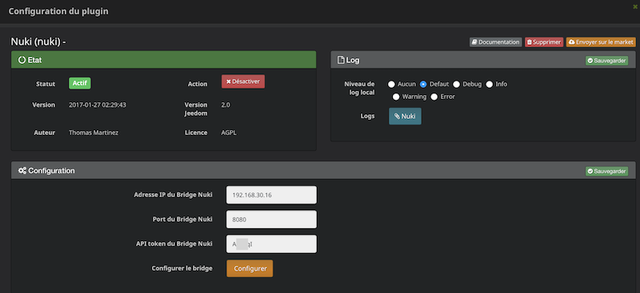
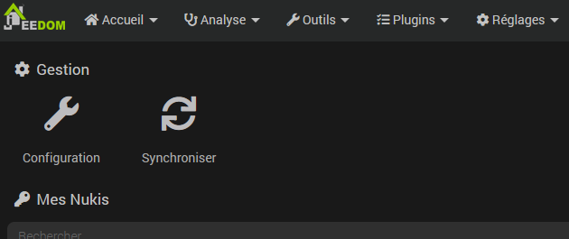

# Nuki Plugin

Mit diesem Plugin lassen sich die vernetzten Nuki-Schlösser über die Bridge steuern.

## Plugin Konfiguration

Nachdem Sie das Plugin heruntergeladen haben, müssen Sie es lediglich aktivieren und anschließend die Bridge-Daten konfigurieren.

Diese Informationen sind in der mobilen App bei der Konfiguration der Bridge verfügbar, nachdem der API-Zugriff auf dieser aktiviert wurde.

Anschließend müssen Sie auf die Schaltfläche „Bridge konfigurieren“ klicken, um der Bridge die Jeedom-Adresse für die Rückmeldung mitzuteilen.

## Gerätekonfiguration

Die Synchronisierung der Schlösser ist über das Menü „Plugins > Sicherheit > Nuki“ zugänglich:

> **Hinweis**
>
> Die Bestellungen werden automatisch erstellt, es ist nicht erforderlich, sie manuell hinzuzufügen.

## Mögliche Werte für den Befehl *Status*

|     | **Smartlock** | **Türöffner**  | **Türsensor** |
|-----|---------------------------|-------------|----------------|
| 0   | Nicht kalibriert | Nicht kalibriert | - |
| 1   | Gesperrt | Online    | Deaktiviert     |
| 2   | Entriegelung | - | Geschlossen |
| 3   | Entriegelt | RTO aktiv  | Offen |
| 4   | Verriegelung | - | Unbekannt |
| 5   | Entriegelt (Riegel)    | Offen | Kalibrierung |
| 6   | Entriegelt (Lock-n-Go) | - | - |
| 7   | Entriegelung (Riegel)   | Öffnen   | - |
| 16  | - | - | Nicht kalibriert    |
| 240 | - | - | Gelöscht |
| 253 | - | Start   | - |
| 254 | Motor blockiert | - | - |
| 255 | Unbekannt | Unbekannt     | - |
